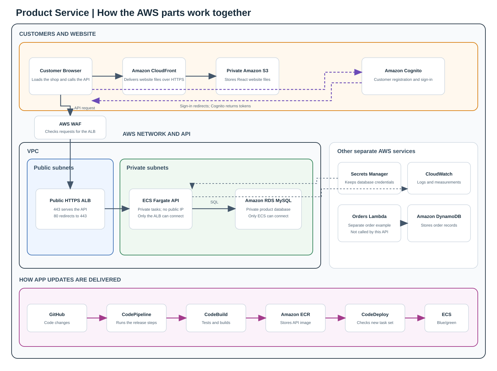

# Product Service

## Introduction

Product Service is a small online shop built with AWS. Customers can look at
products on its website. A Node.js API (a helper the website asks for
information) gets product details from a MySQL database on Amazon RDS. Amazon
Cognito helps customers sign in. A separate Lambda function saves orders in
DynamoDB. CloudFormation describes the AWS resources, and a GitHub pipeline
builds and updates the API on ECS Fargate.

### What is this project?

This project shows how the parts of a small online shop fit together. The
website asks the API for products. The API gets them from the database (an
organized place to keep information). The project also has files that tell
AWS how to set up the website, API, database connection, sign-in, and tools
that release new versions.

### Why was it built?

It was built to learn how to put an app on AWS and update it safely. Customers
can reach the website and API, but the app and database are kept in private
networks. The project also shows how to protect database passwords, check a
new version before customers use it, and save orders with a separate Lambda
function. The setup files are examples; someone still needs to set them up and
test them in an AWS account.

## Project structure

```text
product-service/
├── src/
│   ├── app.js
│   ├── db.js
│   └── server.js
├── frontend/
│   ├── src/
│   ├── Dockerfile
│   └── nginx.conf
├── database/
│   └── init.sql
├── lambda/
│   └── orders/
│       ├── index.js
│       ├── package.json
│       └── package-lock.json
├── cloudformation/
│   ├── ecr-repository.yaml
│   ├── ecs-service.yaml
│   ├── cognito-user-pool.yaml
│   ├── waf-alb.yaml
│   └── frontend-cloudfront.yaml
├── docs/
│   ├── aws-architecture.svg
│   └── deployment.md
├── scripts/
│   └── deploy-frontend.ps1
├── docker-compose.yml
├── appspec.yaml
├── buildspec.yml
├── taskdef-template.json
├── Dockerfile
├── .dockerignore
├── .env.example
├── package.json
└── package-lock.json
```

## Architecture Overview



The diagram uses AWS service pictures. It shows how customer requests and new
software releases travel through different parts of the system.

## AWS Services Used

- **Amazon ECS and AWS Fargate** — Run the API without you managing the
  computers it runs on. Fargate Spot can add extra, lower-cost computers when
  they are available.
- **Amazon CloudFront** — Delivers the website to customers using HTTPS.
- **Amazon S3** — Keeps the website files private. CloudFront is allowed to
  read them; the public is not.
- **Amazon Cognito** — Helps customers sign in to the website.
- **AWS WAF** — Checks web requests for common bad patterns and blocks extra
  requests if too many come from the same internet address.
- **Application Load Balancer (ALB)** — Acts like a front door for the API.
  It sends web requests to the API and sends health checks to see if it is
  working.
- **Amazon RDS for MySQL** — Stores the product information in a database.
- **Amazon ECR** — Keeps the saved packages (container images) used to run the
  API. A container image is a package with the API and what it needs to run.
- **AWS CodePipeline** — Starts the build and update steps when code changes
  in the selected GitHub branch.
- **AWS CodeBuild** — Runs API tests, builds the website and API package, and
  saves the API package in ECR.
- **AWS CodeDeploy** — Starts a new copy of the API and checks it before
  sending customer requests to it.
- **AWS Lambda** — Runs the separate order-saving example when it is called.
  It checks the order and saves it in DynamoDB.
- **Amazon DynamoDB** — Stores orders for the Lambda example.
- **AWS Secrets Manager** — Keeps the database username and password safe and
  gives them to the API when needed.
- **Amazon CloudWatch** — Keeps logs (records of what happened) and shows
  measurements about the app.
- **AWS Identity and Access Management (IAM)** — Controls which AWS actions
  each part of the project is allowed to do.
- **Amazon VPC and security groups** — A VPC is a private network in AWS.
  The ALB is in public subnets; the API and database are in private subnets.
  Security groups act like traffic rules between them. The ECS template uses
  a VPC that already exists.
- **AWS CloudFormation** — Uses setup files to create AWS resources.

## Request Flow

1. A customer's browser gets the website from CloudFront. The website files
   are kept in a private S3 bucket.
2. The browser asks the public API for products. AWS WAF checks the request.
3. The ALB sends the request to the API, which runs in a private part of AWS.
4. The API gets product details from the RDS database and sends them back.
   Secrets Manager safely supplies the database login.
5. Customers sign in with Cognito. The `/me` API route checks that the
   customer's sign-in token (a digital pass showing they signed in) is valid.
6. The ALB and ECS check `/health` to see if the API is working. CloudWatch
   keeps records and measurements.

CloudFront delivers the website. The website talks to the API separately,
using the API address set in its configuration.

## CI/CD Deployment Flow

CI/CD is a way to automatically check and update the app when its code changes.

1. A code change in the chosen GitHub branch starts CodePipeline.
2. CodeBuild checks the API, builds the website, and packs the API into a
   container image. It saves that image in ECR.
3. CodeDeploy starts a new copy of the API. This is called the green version;
   the current copy is called the blue version.
4. The ALB checks the green version. If it works, CodeDeploy sends customer
   requests to it. If it does not work, the old version can keep serving
   customers.

## Order Processing Flow

1. Someone sends an order with an `orderId` to the Lambda function.
2. Lambda saves the order in the existing DynamoDB table. It rejects an order
   if that ID is already there.
3. X-Ray and CloudWatch help show what the Lambda did.

   This project does not connect the Lambda to the shop or an order event.
   It must be called separately.

## Results

- You can run API tests and build the website on your computer. The AWS CLI
  can check the setup files.
- This project does not claim that its AWS services have been set up or that
  a live shop is available.
- Checking a setup file or building the website does not prove that everything
  works after it is set up on AWS.

### Deployment instructions

To set up the project on AWS, follow the
[AWS deployment guide](docs/deployment.md). It lists what you need and the
steps to follow.

## Application API and local run

| Method | Path | Purpose |
| --- | --- | --- |
| `GET` | `/products?page=1&limit=20` | Get a group of products. `page` picks the group; `limit` picks how many. |
| `GET` | `/products/:id` | Get one product by its ID (number). |
| `GET` | `/health` | Check that the API can reach its database. |
| `GET` | `/me` | Get the signed-in customer's profile. A valid Cognito token is required. |

The database needs a table named `products` with columns for `id`, `name`,
`description`, `price`, and `image_url`. Anyone can look at products. Only a
customer with a valid Cognito sign-in token can use `/me`. The API checks that
the pass came from the right sign-in system, has not expired, and is meant for
this app.

To start the website, API, and a practice MySQL database on your computer, run:

```powershell
docker compose up --build
```

Open the website at `http://localhost:5173`. The API is at
`http://localhost:3000`. The practice database starts with sample products.
Signing in still needs a real Cognito User Pool; the local setup does not make
fake sign-in accounts.

To start only the API and connect it to a database you can reach, first install
the needed packages. Then set these database settings:

```powershell
npm ci
$env:DB_HOST = "your-rds-endpoint"
$env:DB_PORT = "3306"
$env:DB_NAME = "products"
$env:DB_USER = "app_user"
$env:DB_PASSWORD = "your-password"
npm start
```

Try these addresses to check the local API:

```powershell
Invoke-RestMethod "http://localhost:3000/health"
Invoke-RestMethod "http://localhost:3000/products?page=1&limit=4"
Invoke-RestMethod "http://localhost:3000/products/1"
```

Do not save real passwords or other secrets in Git.

## Impact & Value

### Technical Impact

- CloudFormation can create the same AWS setup again from the same files.
- Private networks and carefully limited permissions help protect the app and
  its information.
- The pipeline builds and updates the API. It checks the new version before
  sending customers to it.
- Fargate Spot and ECS auto scaling can help balance cost and the number of
  computers running the API.

### Business Value

- Automatic builds and updates mean fewer steps need to be done by hand.
- Health checks help find problems. Blue/green updates can keep the old version
  ready while the new one is checked.
- Fargate Spot may cost less for extra computers when they are available.
- RDS keeps product information, and Secrets Manager keeps database passwords
  out of the API package.

### Key learnings

- Fargate tasks use `awsvpc` networking and need CPU and memory limits.
- Blue/green updates need two target groups (places the ALB can send requests)
  and production and test listener routes.
- Private subnets need a safe path to the AWS services and database they use.
- CloudFormation can check that a setup file is written correctly. The system
  still needs to be set up and tested on AWS to know that all parts work
  together.
